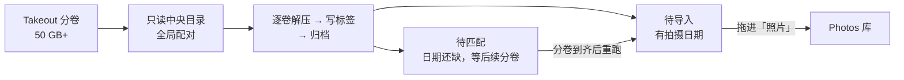

# takeout-photos

把 **Google Takeout 导出的 `.json` 元数据写回照片/视频本身**，让它们可以按真实拍摄时间、地点导入苹果「照片」。

零参数运行，自动找分卷、自动分批、边下边跑、清理分卷不丢元数据。

```bash
takeout-photos            # 就这一条命令
```

---

## 它解决什么问题

Google Takeout 导出照片时，**拍摄时间和 GPS 往往只存在于同名的 `.json` 旁车文件里**，媒体文件本身的 EXIF 可能已被剥离或转换。结果是：

- 直接拖进「照片」App → 所有照片堆在**导入当天**，时间线全乱
- 地点丢失，回忆地图空白
- 访达里文件日期是解压时间

而手工修更麻烦：Takeout 把一次导出拆成 20+ 个 2 GB 分卷，而且**媒体和它的 json 经常不在同一个分卷里**（`IMG_4672.HEIC` 在 001 卷、它的元数据在 002 卷），所以必须先看全部分卷再配对，50 GB 的导出又不可能整个解压。

这个工具就是为这个场景写的。

## 收益

| 导入前 | 导入后 |
|---|---|
| 全部落在导入当天 | 按真实拍摄时间排序，时间线正确 |
| 没有地点 | GPS 写回，回忆地图/「附近」可用 |
| 访达显示解压时间 | 文件日期 = 拍摄时间 |
| 视频日期同样丢失 | `QuickTime:CreateDate` 写回 |
| 手动处理 20+ 分卷 | 一条命令，可断点续跑 |

实测：11 个分卷、4652 个媒体，**40 秒**完成补写与归位；重复运行 0 写入。

## 一键安装

```bash
git clone https://github.com/whyname/takeout-photos.git
cd takeout-photos && ./install.sh
```

`install.sh` 会：检查 `python3` → 缺 `exiftool` 就 `brew install exiftool` → 把 `takeout-photos` / `takeout-photos-dir` 链接到 PATH（`/opt/homebrew/bin`、`/usr/local/bin`、`~/.local/bin` 里第一个可写的）。

只有一个外部依赖：**exiftool**（写 EXIF/XMP/QuickTime 的事实标准）。

## 一键使用

### 1. 分卷还在（推荐，支持边下边跑）

```bash
takeout-photos
```

默认行为，不需要任何参数：

| 用途 | 默认位置 |
|---|---|
| 分卷来源 | 自动在 `~/Downloads`、`~/Desktop` 找 `takeout-*.zip` |
| 输出 | `~/Pictures/Takeout`（访达侧边栏「图片」里可见） |
| 元数据缓存 | `~/Library/Application Support/TakeoutFix/sidecars.json`（几 MB） |
| 暂存 | `<输出>/.staging`（同盘，移动即改名，每卷用完即删） |

输出分成两个目录，**只有第一个该导入**：



- `待导入/` — 已有日期（来自 json，或文件自带的相机 EXIF），可直接导入
- `待匹配/` — 暂时没有任何日期，**先别导入**；等剩余分卷下完后重跑同一命令，能配上元数据的会自动写标签并移到 `待导入/`

### 2. 已经解压好了

```bash
takeout-photos-dir --root ~/Downloads/Takeout/"Google Photos"
```

对已解压目录做同样的事（配对规则、写标签逻辑完全一致）。

## 常用选项（都可不加）

```bash
takeout-photos --dry-run          # 只看配对率与空间需求，不动任何文件
takeout-photos --clean            # 处理完自动删除已完全解压的分卷（释放空间）
takeout-photos --skip-unpaired    # 没有元数据的媒体不解出来（省空间）
takeout-photos --overwrite        # 用 json 覆盖文件里已有值（默认只补空缺）
takeout-photos --tz +08:00        # 时区，默认本机
```

## 配对规则

Takeout 的文件命名有好几种真实形态，全部支持：

| 媒体 | 旁车 json |
|---|---|
| `IMG_1.JPG` | `IMG_1.JPG.json` |
| `IMG_1.JPG` | `IMG_1.JPG.supplemental-metadata.json`（新导出） |
| `IMG_2(1).JPG` | `IMG_2.JPG(1).json`、`IMG_2.JPG.supplemental-metadata(1).json` |
| `IMG_3.HEIC` | `IMG_3.HEIC.supplemental-metadata(1).json`（编号只出现在 json 上） |
| `IMG_4-edited.JPG` | `IMG_4-edited.JPG.json` |
| `IMG_5-edited.JPG` | `IMG_5.JPG.json`（原图没导出，只有修图版） |

相册/`metadata.json`（不含 `photoTakenTime`）自动跳过；找不到媒体的 json 单独报告，不猜。

## 写入的内容

| 目标 | 写入 |
|---|---|
| 照片 | `EXIF:DateTimeOriginal`、`CreateDate`、`ModifyDate`、`OffsetTime*`、GPS 全套、`ImageDescription`/`XMP:Description` |
| 视频 | `QuickTime:CreateDate/ModifyDate/CreationDate`、`QuickTime:GPSCoordinates`（ISO 6709） |
| 文件 | `FileModifyDate`/`FileCreateDate` 钉到拍摄时间 |
| HEIC | 自带日期只存在 QuickTime 里时，镜像进 EXIF（「照片」和访达都能读） |

默认**只补空缺**：文件里已有的相机 EXIF 不会被覆盖（相机自己的数据更可信），需要强制覆盖用 `--overwrite`。

## 数据安全

- 不联网，不上传任何东西，只用本地 `exiftool`
- 只有 `--clean` 会删分卷，且只删「该卷所有媒体都已归档 + 元数据已缓存」的卷；其他保留并报告
- 删了分卷也不丢元数据：json 内容缓存在 `sidecars.json`，后续分卷的媒体照样能配上
- 写入失败的文件留在 `待匹配`，不会混进 `待导入`；后缀与内容不符的（如 `.JPG` 实为 MOV）记入 `.takeout-unwritable.json`，不再反复重试
- 幂等：重复运行 0 写入，可随时中断再跑

## 时区说明

Takeout 只保存绝对 UTC 时间戳，**不保存时区**。`--tz` 决定换算成哪个本地时间（默认本机时区）。跨境拍摄的照片无法还原当时时区，需要时按文件夹分批运行。

## 常见问题

**为什么有些 json 配不上？**
媒体和元数据被分到不同分卷，且你还没下载全。用 `--dry-run` 看配对率；把所有分卷放进同一目录后重跑即可。

**为什么有的文件显示「今天」？**
旧版本遗留，或文件的自带日期只在 QuickTime/Apple 键里。当前版本会把日期镜像进 EXIF 并钉住文件时间；`待导入` 中已无此类文件。

**视频没有 EXIF 日期？**
正常。视频用 `QuickTime:CreateDate`，「照片」读的就是它。

**磁盘不够怎么办？**
`takeout-photos` 会自动按可用空间分批，放不下的分卷留到下次；空间不足时会询问是否删除已完全解压的分卷。峰值 = 输出目录 + 1 个分卷。

## 开发

```bash
python3 -m unittest discover -s tests     # 30 项，覆盖配对/时区/HEIC/视频/断点/清理
```

需要 `exiftool`；视频相关测试需要 `ffmpeg`（缺失时自动跳过）。

## License

MIT
